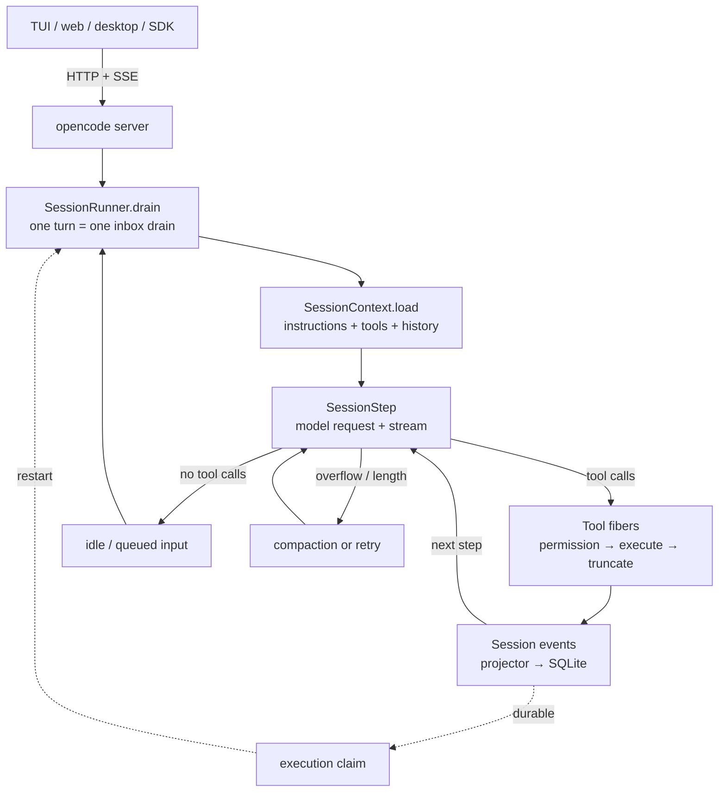
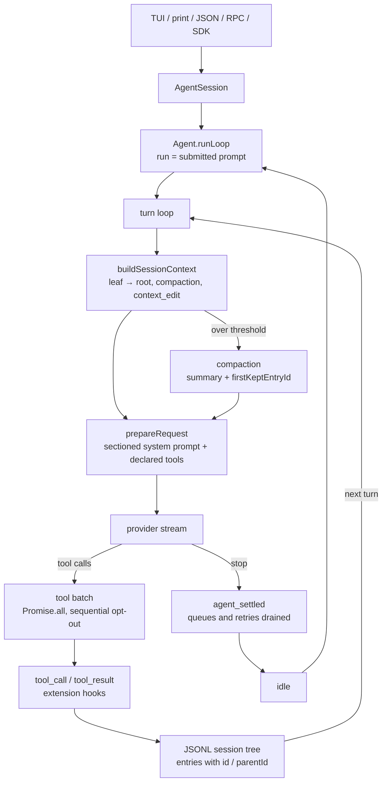
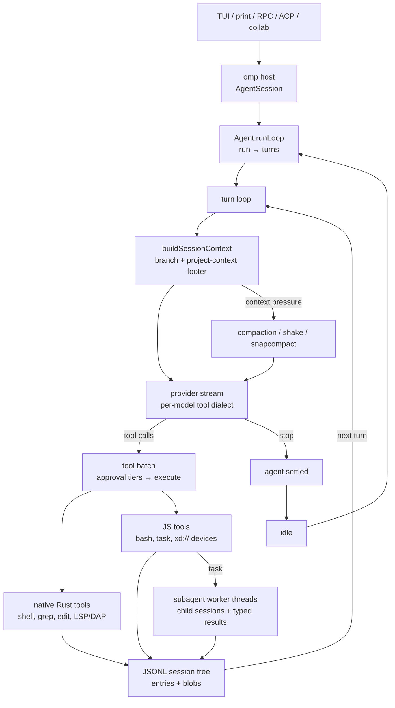

# Agent harness comparison: opencode, pi, oh-my-pi

Three MIT-licensed coding agents, all TypeScript-first, all with a terminal UI, and all built around the same basic loop: system prompt + tools + provider stream + tool results. Below that shared shape they diverge sharply: opencode is a client/server platform with an event-sourced database, pi is a deliberately minimal extensible library, and oh-my-pi is a maximal fork of pi with a large native Rust core.

This is a static implementation comparison at the commits below. No benchmarks were run; performance claims from READMEs are marked as such.

Repository layout: the harness trees are git submodules under `code/`. Paths in this document are relative to each harness root, so `opencode/packages/...` means `code/opencode/packages/...`, and likewise for `pi/` and `oh-my-pi/`.

## Agentic loop at a glance

All three harnesses run the same high-level loop: assemble context, stream a model response, execute the requested tools, append the results, and continue until the model stops asking for tools. The differences are in where that loop lives, how tool calls are scheduled, and what makes a turn durable.

The diagrams are simplified; the sections below cite the exact implementation files.

### opencode: client/server, event-sourced

The server owns the loop, tools, permissions, providers, and SQLite. The TUI and web/desktop clients only send requests and consume events. Each streamed tool call runs in its own Effect fiber, and a write-ahead execution claim makes an interrupted turn resumable.

### pi: in-process, tree-shaped context

Everything runs in one process. Extensions are ordinary TypeScript loaded in-process and can replace built-ins. The transcript is an append-only tree, and model context is a projection of the active branch; tool calls are scheduled with `Promise.all` unless a tool opts into sequential execution.

### oh-my-pi: native tools, worker-thread subagents

oh-my-pi keeps pi's single-host model but moves search, shell, AST edits, VCS, and diffing into an in-process Rust addon. Subagents are child sessions on pooled worker threads rather than separate CLI processes, and the tool surface includes `xd://` devices that are invoked through `read`/`write`.

### What the diagrams make obvious

- **State ownership**: only opencode separates the loop from its clients. pi and oh-my-pi run the loop in the CLI process.
- **Durability**: opencode's loop is backed by an event-sourced database and a resumable execution claim; pi and oh-my-pi replay an append-only JSONL tree.
- **Tool scheduling**: opencode forks a fiber per tool call; pi uses a promise batch with an opt-out; oh-my-pi batches native and JS tools and can hand work to worker-thread subagents.
- **Compaction**: all three loop back through a reduced context, but opencode can precompute a summary in the background, pi appends a compaction entry, and oh-my-pi can choose LLM compaction, mechanical shake, or snapcompact.

## Snapshot

| | opencode | pi | oh-my-pi (`omp`) |
|---|---|---|---|
| Repo | `anomalyco/opencode` | `earendil-works/pi` | `can1357/oh-my-pi` |
| Version inspected | 2.2.5 | 1.5.0 (`@earendil-works/pi-coding-agent`) | 18.18.3 (`@oh-my-pi/pi-coding-agent`) |
| Commit | `ed0171f08a` | `b9ac5c1a0` | `0f0af17b97` |
| Default branch | `dev` | `main` | `main` |
| Runtime | Bun 1.4.4 | Node.js ≥ 22.19 (Bun optional for binaries) | Bun ≥ 1.4.4 |
| Non-test TS/TSX | ~828k lines / 6,692 files | ~352k lines / 3,294 files | ~1.15M lines / 6,813 files |
| Rust | none first-party | none first-party | ~727k lines in 12 first-party crates |
| Primary surfaces | TUI, web, Electron desktop, HTTP server | TUI, print/JSON, RPC, SDK | TUI, print/RPC/ACP, SDK, collab web |

Lineage matters here:

- **pi** is the smallest and the ancestor of the other two conceptually: a minimal harness whose README explicitly says it ships without sub-agents and plan mode, and expects extensions to add them (`pi/README.md`).
- **oh-my-pi** is a fork of `badlogic/pi-mono` (now `earendil-works/pi`) and keeps the `pi-*` package names, the `pi-` role-selector prefix, and several `legacy-pi-*` compatibility shims (`oh-my-pi/packages/coding-agent/src/*/legacy-pi-*`, `oh-my-pi/README.md`). Its additions are mostly surface area and native code.
- **opencode** shares no lineage with either. It is the most "productized" of the three: multiple clients, a long-lived daemon, migrations, and a plugin ecosystem.

## Architecture

### Process model and transport

| Axis | opencode | pi | oh-my-pi |
|---|---|---|---|
| Who owns the agent loop | A background server process | The CLI process | The CLI process |
| Clients | TUI, web app, Electron, SDK all speak HTTP | TUI/print/JSON/RPC/SDK in one process | TUI/print/RPC/ACP/collab around one host |
| API | Effect `HttpApi`, `/api/...`; SSE event feed; WebSockets for PTY and optional provider streams | JSONL RPC over stdio; JSON event mode; in-process SDK | Newline-delimited JSON RPC (not JSON-RPC 2.0); ACP for editors; sealed-frame collab relay |
| Crash recovery | Event-sourced SQLite plus a write-ahead execution claim; a killed turn resumes on next start | Session file is the record; no in-flight turn recovery | Session file is the record; no in-flight turn recovery |
| Subagent execution | Child session in the same server, foreground or background | Not built in; example extension spawns another `pi` process | Child session on a pooled worker thread, with parking/revival |

Key files: `opencode/packages/core/src/session/runner/step.ts`, `opencode/packages/core/src/session/execution.ts`, `opencode/packages/server/src/event-feed.ts`; `pi/packages/agent/src/agent-loop.ts`, `pi/packages/coding-agent/src/core/agent-session.ts`; `oh-my-pi/packages/agent/src/agent-loop.ts`, `oh-my-pi/packages/coding-agent/src/session/session-manager.ts`, `oh-my-pi/packages/coding-agent/src/task/executor.ts`.

**opencode** is the outlier. The TUI is a client of a per-user daemon discovered through a registration file; `--standalone` still forks a `serve --stdio` child. The rationale is continuity: sessions stay live across TUI, web, desktop, and IDE clients, and a server restart can resume a claimed turn. The cost is a large service graph and 59 migrations (`opencode/packages/core/src/database/migration/`).

**pi** is one process, one session, one extension runtime. Extensions are loaded in-process with `jiti`, so they share classes and OS permissions with the harness (`pi/packages/coding-agent/src/core/extensions/loader.ts`). MCP servers are child processes; `bash` spawns a shell per call.

**oh-my-pi** keeps pi's single-host model but pushes work into native code and worker threads. Search, glob, shell, AST edits, VCS, isolation, and diffing are in-process Rust through an N-API addon (`oh-my-pi/crates/pi-natives`), and subagents run on pooled worker threads rather than as separate CLIs.

### Agent loop and concurrency

All three stream provider deltas, emit typed events, execute tool calls, and continue until the model stops requesting tools. The differences are in scheduling and durability.

| | opencode | pi | oh-my-pi |
|---|---|---|---|
| Loop unit | Turn = one inbox drain; steps until no tool calls | Run = submitted prompt; turns; inner tool loop | Run = submitted prompt; turns; inner tool loop |
| Tool scheduling | One scoped Effect fiber per streamed tool call, awaited before the next step | `Promise.all`, unless a tool declares `sequential` or settings force it | Parallel tool execution; background/async jobs supported |
| Steering | `steer` at a step boundary, `queue` for the next idle turn | Steering after the current assistant turn; follow-ups after the run settles | Steering messages and interrupts; `wait` for background results |
| Interruption | Fibers, snapshots, and persisted execution claim | Stream abort with continuation support | Stream abort, checkpoint/rewind, parked agents |

`opencode/packages/core/src/session/runner/step.ts` is worth reading for the concurrency model alone: provider events are consumed in order, a local tool starts only after its `Tool.Called` event is published, and each tool runs in its own fiber so cancellation remains local.

### Session and state model

| | opencode | pi | oh-my-pi |
|---|---|---|---|
| Store | SQLite, event-sourced (`event`, `event_sequence`) plus projections | Append-only JSONL tree | Append-only JSONL tree |
| Branching | Fork child session with boundary message | `id`/`parentId` tree plus `leafId`; `/tree`, `/fork`, `/clone` | Same tree model; `/fork`, `/tree`, `/fork pane\|window\|tab` |
| Compaction record | `compaction` message with summary and kept message ID | `compaction` entry with summary and `firstKeptEntryId` | Compaction entry; also branch summaries and handoff summaries |
| Context reconstruction | Projector + instruction entries + message parts | Walk leaf→root, apply latest compaction and `context_edit` | `buildSessionContext` over the branch |
| Large payloads | Blobs in DB/file store | Tool output spilled to temp files; session remains JSONL | `blob:sha256:` content-addressed blobs plus artifacts |

pi and oh-my-pi share the same fundamental insight: the transcript is an append-only audit log, and model context is a projection of the active branch. opencode takes the same idea further by making the transcript a database with typed projections, which buys replay and crash recovery at the cost of schema complexity.

### Tool pipeline and permissions

| | opencode | pi | oh-my-pi |
|---|---|---|---|
| Registry | `Tool.Service` transform chain; plugins can add/update/remove/namespace; snapshot per request | `ToolDefinition` objects with name, description, params, `promptSnippet`, `promptGuidelines`, `exposure` | 30 canonical built-ins plus hidden tools, plugins, MCP, and `xd://` devices |
| Validation | Effect/Standard Schema at execution; declared output checked | TypeBox/`pi-schema`; validation at the trust boundary | JTD/omptype schemas; native and device tools use the same validator |
| Permissions | Rules `{action, resource, effect: allow\|deny\|ask}`, last match wins, default ask; agent/session rules merge; denied tools disappear from the snapshot | None built in; tools run with the user's OS permissions; extensions can gate `tool_call` | Tiers `read`/`write`/`exec`, policy `allow\|deny\|prompt`, modes `always-ask`, `always-ask-cached`, `write`, `yolo` (default `yolo`) |
| Edit model | `oldString`→`newString` with fuzzy normalization tiers, unique match or `replaceAll`; plus a custom patch format | Exact multi-edit replacement across disjoint, unique spans; no patch language | Hashline by default: 4-hex content tags, line ops `PUT`/`CUT`/`MV`/`REM`, stale-tag rejection/relocation; other modes available |
| Shell | Persistent PTY sessions over WebSocket; background jobs | Fresh shell per call; no persistent PTY | Embedded bash 5.3 engine with persistent sessions, in-process coreutils, optional PTY |
| IDE intelligence | Config/events only; no runtime LSP; no DAP | None | 14 LSP actions (including `rename_file` through `workspace/willRenameFiles`) and 28 DAP actions |

The permission contrast is stark and deliberate:

- opencode treats permission as a first-class service and filters the tool list by policy.
- pi treats sandboxing as an OS/container concern and documents three containerization patterns instead (`pi/packages/coding-agent/docs/containerization.md`).
- oh-my-pi ships a full approval system but defaults to `yolo` (`oh-my-pi/packages/coding-agent/src/tools/settings.ts`).

## Stack and build

| | opencode | pi | oh-my-pi |
|---|---|---|---|
| Language | TypeScript on Bun, Effect 4 | TypeScript ESM, erasable syntax, Node 22 | TypeScript on Bun, Rust |
| Monorepo | Bun workspaces: 30+ packages plus services | npm workspaces: 12 packages plus apps | Bun workspaces: 16 packages, Cargo workspace, Python bot |
| UI | OpenTUI + Solid (`@opentui/*`); Solid web app; Electron desktop | Custom differential-rendering TUI; no first-party web UI | Custom TUI; web surfaces for stats/collab |
| Schemas | Effect Schema | TypeBox + `pi-schema` | `omptype` (ArkType-compatible lazy JIT) |
| Persistence | Drizzle over SQLite, three runtime adapters (`bun`, `node`, `workerd`) | JSONL files | JSONL files + SQLite for stats/memory |
| Provider layer | `@opencode/ai` implements protocols directly, plus `aisdk:` compatibility | `packages/ai` implements wire APIs (`anthropic-messages`, `openai-responses`, Google, Bedrock, Mistral, Azure, …) | `packages/ai` plus `packages/catalog`; per-dialect tool-call encoders (Anthropic, Harmony, Hermes, Gemini, Qwen, GLM, Kimi, DeepSeek, MiniMax, XML) |
| Native | Patched `node-pty`, `@parcel/watcher`, Photon WASM | N-API prebuilds for clipboard/modifiers; QuickJS WASM; Photon WASM | 12 Rust crates: shell engine, coreutils, edit, AST, walker, VCS, isolation, VFS, diff, prediction, voice, natives |
| Build | Bun cross-compile to 12 targets; optional platform packages | `tsc` + esbuild bundle + `bun build --compile` | Bazel for hermetic native artifacts, Cargo locally, Bun compile to 8 targets |
| Distribution | npm, install script, brew, pacman/AUR, mise, nix, desktop installers | npm, curl/PowerShell installers, nix, standalone binaries | npm, curl, brew, nix, mise, PowerShell, standalone binaries |

opencode's dependency graph is enforced by repository rules: `schema` → `core`/`protocol` → `server`, with client code forbidden from importing core or server (`opencode/AGENTS.md`). pi and oh-my-pi both use package boundaries and per-package type checks, but neither has an equivalent layering law.

## Feature set

Legend: **Y** built in, **P** partial/experimental/config-gated, **E** example or extension only, **N** absent.

| Feature | opencode | pi | oh-my-pi |
|---|---|---|---|
| File read/write/edit | Y | Y | Y |
| Patch language | Y (`patch`) | N | Y (multiple edit modes) |
| Glob/grep | Y | Y (inactive by default) | Y (native walker) |
| Shell | Y (persistent PTY) | Y (per-call) | Y (embedded bash + PTY) |
| Code execution sandbox | Y (Code Mode interpreter) | Y (`codemode`, QuickJS/WASM) | Y (persistent Python + Bun kernels) |
| Web fetch/search | Y | N built in | Y (multi-provider search chain) |
| Browser automation | P (requires desktop attached) | N | Y (Chromium/Electron tabs, stealth, relay) |
| Subagents | Y (child sessions, background) | E (`examples/extensions/subagent`) | Y (worker threads, typed results, Agent Hub) |
| Skills | Y (`SKILL.md`, compatibility roots) | Y (Agent Skills, on-demand load) | Y (`SKILL.md` + `skill://`) |
| MCP | Y (stdio/HTTP/OAuth; tools, prompts, resources) | Y (stdio/HTTP, OAuth, replaceable extension) | Y (stdio/HTTP/SSE/WebSocket, OAuth, resources) |
| Plugins/extensions | Y (in-process, Effect context, GUI plugins) | Y (in-process TypeScript, broad event API) | Y (in-process TypeScript, hooks, marketplace) |
| Plan mode | Y (plan agent + reminders) | E (example extension) | Y (plan files, approval flow) |
| Todos | Y (`todowrite`) | E (example extension) | Y (`todo`, phased) |
| Goals / autonomous loop | Y (`goal` plugin with judge) | N | Y (`goal` tool + goal mode) |
| LSP | P (schema/events only, no runtime) | N | Y (14 actions) |
| DAP/debugger | N | N | Y (28 actions) |
| Session tree/fork | Y | Y | Y |
| Session export/share | P (share looks legacy) | Y (HTML export, JSONL) | Y (export, `/collab`, `omp join`) |
| Persistent memory | N | N | Y (local, Hindsight, Mnemopi, sharpshooter) |
| IDE integration | Y (ACP server) | N (editor via `$EDITOR`) | Y (ACP, Cursor bridge) |
| Web/desktop UI | Y (web + Electron) | P (`apps/p2`, experimental) | Y (collab web, stats) |
| Local analytics | Y (`stats` package) | P (telemetry contracts) | Y (`omp stats` dashboard) |
| SDK / headless | Y (`@opencode/sdk`, `run`, `api`) | Y (SDK, print, JSON, RPC) | Y (SDK, print, RPC, ACP) |
| Built-in approvals | Y (allow/ask/deny) | N | Y (tiers, default yolo) |
| Containerization story | Server process + permissions | Documented Gondolin/Docker/OpenShell | Isolation backends, auth gateway |

### Built-in tools by name

- **opencode**: `shell`, `read`, `write`, `edit`, `patch`, `glob`, `grep`, `webfetch`, `websearch`, `todowrite`, `subagent`, `skill`, `question`, `experimental_image_generate`. Code-Mode-only: `execute`, `artifact_*`, `schedule_*`, `list_mcp_resources`, `read_mcp_resource`, `opencode.*`; the desktop-attached browser plugin adds `browser.*`.
- **pi**: `read`, `bash`, `powershell`, `edit`, `write`, `grep`, `find`, `ls`. Default active: `read`, `bash`, `edit`, `write`.
- **oh-my-pi**: `read`, `bash`, `edit`, `ast_grep`, `ast_edit`, `ask`, `debug`, `ida`, `eval`, `github`, `glob`, `grep`, `find`, `lsp`, `checkpoint`, `rewind`, `context_notes`, `new_context`, `security_scan`, `task`, `wait`, `todo`, `web_search`, `write`, `memory_edit`, `retain`, `recall`, `reflect`, `learn`, `manage_skill`; hidden: `think`, `yield`, `goal`. `browser`/`computer` are eval preludes, not canonical tools.

The tool counts are a proxy for philosophy: pi ships 8 primitives and expects composition; opencode ships 14 direct tools and hides most of the rest behind Code Mode; oh-my-pi ships 30 and keeps adding specialized surfaces.

## Prompting and prompt glossaries

"Prompt glossary" here means two things: the prompt artifacts a harness maintains, and the vocabulary it deliberately teaches the model so it can operate the harness. The three implementations answer both questions differently.

### Three prompt philosophies

**opencode: one short canonical prompt, overridden per model family.**

The base is a 15-line `system.txt` (`opencode/packages/core/src/session/runner/prompt/system.txt`) with a `${OPENCODE_TOOL_GUIDANCE}` slot filled by tool-conditional lines in `session/system-prompt.ts`. On top of that, `plugin/optimize.ts` replaces the system message for recognized model families:

| File | Selected when | Mode |
|---|---|---|
| `plugin/system-prompt/gpt.txt` | model id contains `gpt` | replace |
| `plugin/system-prompt/gpt-astra.txt` | id contains `gpt` and `astra` | replace |
| `plugin/system-prompt/anthropic.txt` | id contains `claude` | append |
| `plugin/system-prompt/kimi.txt` | id contains `kimi` | replace |
| `plugin/system-prompt/trinity.txt` | id contains `trinity` | replace |
| `plugin/system-prompt/meta.txt` | id contains `muse` | replace, with `{{MODEL_NAME}}` |

Agents with their own `system` string skip the override entirely. Built-in agent prompts (`general`, `explore`, `title`, `summary`, plan reminders) are inline TS constants (`plugin/agent.ts`, `plugin/plan.ts`), not files. Instruction sources are assembled as a second system part, ordered most-shared → least-shared so the cacheable prefix survives; later `AGENTS.md` edits become durable `session.instructions.updated` events rendered as history rather than prefix rewrites (`session/context.ts`, `instruction-discovery.ts`).

**pi: the prompt is a code-built section map with delta patches.**

There are no default prompt Markdown files. `buildSystemPromptSections()` produces an ordered map, each named section wrapped in an XML tag of the same name:

1. `preamble` — untagged role statement.
2. `tools` — one line per declared tool with its snippet.
3. `rules` — tool guidelines plus extension rules, concision and file-path rules.
4. `docs` — self-documentation paths and a topic map for harness questions.
5. `addendum` — `APPEND_SYSTEM.md`.
6. `project_context` — `<project_instructions path="...">`.
7. `skills` — `<available_skills>`.
8. `cwd`.
9. Extension sections (validated names; `preamble` forbidden).

The first request persists all sections; later changes persist as system messages containing section patches (`null` removes), replayed by `getCurrentSystemMessage()` (`packages/ai/src/utils/transcript.ts`). This is the most cache-aware design of the three: stable sections remain byte-identical, and only changed sections are re-sent when the provider supports mid-conversation system messages.

One observed sharp edge: a custom `SYSTEM.md` or SDK `customPrompt` becomes the `preamble` and suppresses the generated `tools`, `rules`, and `docs` sections (`buildSystemPromptSections`), even though the docs describe only prompt replacement.

**oh-my-pi: a prompt file per concept, rendered with Handlebars.**

oh-my-pi forbids inline prompt strings by convention. There are 280 prompt files under `packages/coding-agent/src/prompts/`, imported as text and rendered by a custom Handlebars engine (`packages/utils/src/prompt.ts`). The main template is `prompts/system/system-prompt.md` (280 lines), assembled as:

1. Block 0: `system-prompt.md`, or a custom `SYSTEM.md`, or a user `SYSTEM_TEMPLATE.md`.
2. Eval prelude guidance for active kernels (`browser`, `computer`, `ratchet`, …).
3. One trailing `<project-context>` footer: workstation, repo rules, deeper `AGENTS.md` pointers, workspace tree, append text.
4. For subagents, a role block appended after the footer.

The footer is last on purpose: Anthropic's cache breakpoint sits before it, so sessions and subagents in different worktrees share the static prefix (`docs/system-prompt-customization.md`). Per-tool prompts are separate files gated on live settings (`prompts/tools/read.md`, `bash.md`, `edit` variants), and the tool inventory itself can render compact or full with schemas and examples.

### Prompt inventory

| Concern | opencode | pi | oh-my-pi |
|---|---|---|---|
| Main system prompt | `session/runner/prompt/system.txt` (15 lines) + provider variants | `core/system-prompt.ts` (code) | `prompts/system/system-prompt.md` (280 lines, Handlebars) |
| Tool descriptions | Schema `description` fields + inline strings | `description` + `promptSnippet` + `promptGuidelines` per tool | `prompts/tools/*.md` (88 files) |
| Project instructions | `AGENTS.md` walk + live diffs; `read` injects nearby files | `AGENTS.override.md`/`AGENTS.md`/`CLAUDE.md` up the tree, into `<project_instructions>` | Multi-ecosystem discovery into one `<project-context>` footer |
| Skills | `<available_skills>` + `skill` tool | `<available_skills>` + on-demand `read` | skill metadata + `skill://` |
| Slash commands | `command/{initialize,review,schedule}.txt` + user markdown | Markdown templates with `$1`/`$ARGUMENTS` | Bundled command prompts + user templates |
| Subagents | Agent `system` constants; `subagent` tool description | Example extension supplies prompts | `prompts/agents/*.md` + `subagent-system-prompt.md` |
| Compaction | Fixed template (Objective, Requirements, Decisions, Work State, Next Move, Files, Context) | Structured summary headings + branch summary | `packages/agent/src/compaction/prompts/*`, plus semantic-compression prompt |
| Mode prompts | Plan enter/leave `<system-reminder>`; goal kickoff/judge | Extension-defined | Plan, vibe, goal, TTSR, retry, interrupted-thinking files |
| Per-model tuning | Six family prompts keyed by id substring | Model-specific compaction overrides | Per-model tool-call dialects, compact edit prompts, intent fields |

### Glossary: vocabulary the harness teaches the model

| Concept | opencode | pi | oh-my-pi |
|---|---|---|---|
| Unit of work | *turn* = one inbox drain; *step* = one model request | *turn*; *run* = submitted prompt through retries/queues; `agent_settled` is true idleness | *turn*; *run*; background/async jobs |
| Conversation state | *session*, *event*, *projection*, *location* | *entry*, *tree*, *leaf*, *active branch* | *entry*, *tree*, *leaf*, *branch* |
| Prompt unit | system part 1 + system part 2 + instruction events | *section* + *addendum*, patched by name | *block 0* + *prelude* + *project-context footer* |
| Tool availability | *snapshot*, *Code Mode catalog*, namespaces | *loadout*, *active*, *exposure* (`direct`, `model-only`, `codemode`, `deferred`, `hidden`) | *Tool Inventory*, *xdev device* (`xd://`), hidden tools |
| Editing | `oldString`/`newString`, patch grammar | exact multi-edit | *hashline*, `#TAG`, `PUT`/`CUT`/`MV`/`REM` |
| Delegation | *subagent*, `sessionID` continuation, background job | extension-defined | *task*, *scout*, *reviewer*, *seance*, *IRC peer*, *parked/revived* |
| Permission | *rule*, *ask*, *always*, *reject*, *external_directory* | none | *tier* (`read`/`write`/`exec`), *mode*, *yolo* |
| Context reduction | *compaction*, *checkpoint*, `<recent-context>` | *compaction*, *branch summary*, *context_edit* | *compaction*, *shake*, *snapcompact*, *pruning* |
| Discovery | *instruction*, *reference*, *skill* | *resource*, *package*, *loadout* | *capability*, *discovery provider*, *rule*, *internal URL* |
| Product nouns | *goal*, *schedule*, *worktree*, *artifact*, *pair* | *pi package*, *virtual model* | *advisor*, *spotlight*, *ratchet*, *prewalk*, *vibe*, *workpool*, *metaharness* |

The last row is the clearest cultural difference. opencode names features the model should use. pi names architectural concepts the model should respect. oh-my-pi names an entire internal folklore—`xd://`, TTSR, snapcompact, shake, seance, workpool—most of which is documented in prompt files and `docs/`.

### Behavioral rules encoded in prompts

- **opencode** leans on per-model rules: the GPT prompt adds commentary-vs-final channels, destructive-action limits, and a delegation gate; the base prompt forbids shell command chaining and treats `<system-reminder>` as harness authority.
- **pi** keeps the base prompt short and composes behavior from tool snippets and guidelines. The `docs` section is unusual: it tells the model to read pi's own documentation before changing the harness.
- **oh-my-pi** uses RFC-2119 keywords (`MUST`, `NEVER`, `SHOULD`), an explicit delivery contract, a six-phase workflow, delegation tiers, and `<critical>` blocks. It is the most prescriptive of the three and the most sensitive to configuration: roughly twenty settings can change the rendered prompt (`cfgSystemPromptInputs`).

## Context management

| | opencode | pi | oh-my-pi |
|---|---|---|---|
| Trigger | Estimate, provider overflow error, or `/compact` | Projected tokens > window − `reserveTokens` (16,384), or `/compact` | Provider window, manual, or policy |
| Retention | `keep` verbatim tail; default buffer 15% of window, minimum 16k | `keepRecentTokens` default 20k | Configurable compaction/keep; pruning bounded by provider cache lookback |
| Summarizer | Dedicated hidden compaction agent; fixed template; native provider compaction supported | LLM summary with structured headings; separate branch summarizer | LLM compaction; *shake* for mechanical tool-result replacement; optional LLM-free snapcompact |
| Background work | `precompute` starts a summary ~60k tokens early | Cache warmer refreshes provider caches when savings exceed $0.05 | Cache warmer and cache-status line |
| Cache strategy | Instruction ordering, instruction deltas as messages, session affinity IDs | Stable section diffs; one-off summaries disable cache writes | Static prefix before cwd-derived footer; per-provider cache compat modules |
| Extra | Measured + estimated token accounting | Append-only `context_edit` entries; branch summaries | `snapcompact` rasterizes history into PNG frames for vision models; memory injection |

**snapcompact** deserves a note because it is unique: instead of asking a model to summarize, oh-my-pi serializes discarded history and renders it as dense PNG glyph frames tuned per provider, then re-attaches those images on every context rebuild (`oh-my-pi/packages/snapcompact/README.md`). It trades text tokens for image tokens and removes a summarization call.

## Extensibility and integration

| | opencode | pi | oh-my-pi |
|---|---|---|---|
| Config | JSONC `opencode.json`/`.opencode/`, layered global → project → env → managed | JSON settings under `~/.pi/agent` and `.pi`, plus packages | YAML `config.yml`, `models.yml`, `mcp.json` under `~/.omp` and `.omp` |
| Extension API | `@opencode/plugin` promise/Effect/RPC/TUI/GUI; hook domains session, tool, permission, shell, aisdk | Default-export factory with `ExtensionAPI`; register tools/commands/providers/renderers; broad event list | `ExtensionAPI` with events, tools, commands, shortcuts, renderers; plugin marketplace |
| Replaceable built-ins | Yes, via transform chain | Yes (`codemode`, `tool_search`, `mcp`, llama.cpp) | Yes, plus capability/discovery providers |
| Compatibility imports | `.claude`, `.agents` for agents/skills | Agent Skills locations | `.omp`, `.claude`, `.codex`, `.gemini`, Cursor, Windsurf, Cline, VS Code, OpenCode |
| Headless | `run`, `api`, `acp`, `serve --stdio` | print, JSON, RPC, SDK | print, RPC, ACP, SDK |
| Editor integration | ACP server | `$EDITOR` only | ACP with `fs/*` and `terminal/*` routing, Cursor bridge |

The compatibility row is a useful signal. pi supports the Agent Skills convention but otherwise stays inside its own format. opencode imports skills and agents from Claude-compatible roots. oh-my-pi treats other harnesses' config as a discovery source, including their rules and MCP servers.

## Testing and quality signals

| | opencode | pi | oh-my-pi |
|---|---|---|---|
| TS tests | `bun test`; 311 `*.test.ts` in `packages/core/test` | Vitest; 354 `*.test.ts` under `packages/coding-agent/test` | `bun test` sharded; ~3,413 `*.test.ts` under `packages/` |
| Deterministic agent tests | Event simulation + recorded HTTP/WS cassettes | `faux` provider suite with in-memory model registry | Prompt-inventory tests, ACP conformance, fork/cache-key tests |
| UI tests | Playwright + happy-dom + TUI stories | TUI tests with `node:test` | TUI/runtime shards, smoke probes |
| Native tests | n/a | n/a | `cargo nextest` + doctests; clippy/rustfmt |
| Other | ast-grep rules with tests | Dependency/install-lock checks | Python pytest for RPC SDK and robomp |
| Supply chain | Bun lockfile; patched native deps | Exact pins, `min-release-age`, `--ignore-scripts`, install lock, audits | Bun lockfile; Cargo deny; Bazel hermetic toolchains |

All three have meaningful test infrastructure. The interesting split is determinism: pi's `faux` provider and opencode's cassette/simulation layers are designed for reproducible agent runs, while oh-my-pi's investment is in native correctness and prompt drift guards.

## Tradeoffs

**opencode: the platform.**
Strongest multi-client story, crash-resumable sessions, event-sourced audit trail, and the most ambitious tool-surface idea (Code Mode). It is also the heaviest to reason about: Effect service graph, 59 migrations, server/client version skew, and a daemon lifecycle. LSP is scaffolding only at this commit, and browser tools require the Electron desktop.

**pi: the library.**
The clearest architecture and the smallest surface: 8 tools, one process, code-built prompt sections with delta patches, a session tree, and an extension system that can replace core features. The tradeoff is explicit: no permissions, no sandbox, no LSP/DAP, no subagents, no plan mode, no todos. Those are examples or third-party packages, so quality and safety vary by installation.

**oh-my-pi: the maximal harness.**
The broadest built-in feature set by a wide margin: native search/shell/VCS/edit, LSP and DAP, subagents with typed results and IRC, memory, browser automation, ACP, collab, stats, and a 280-file prompt system. The costs are proportionate: ~1.8M first-party lines, a native build matrix, default-`yolo` approvals, README claims that drift from code (30 vs "31" built-ins, ~727k vs "~80k" Rust lines, 16 role ids vs "nine"), and a prompt surface where reproducing a given prompt requires the exact config and model.

### Choosing by constraint

| If the constraint is… | Best fit |
|---|---|
| Multiple clients or remote sessions | opencode |
| Crash recovery / durable turns | opencode |
| Minimal, auditable core | pi |
| Extensions that replace core behavior | pi |
| Built-in LSP/DAP and native performance | oh-my-pi |
| Zero-setup breadth (subagents, memory, browser) | oh-my-pi |
| No built-in approval boundary | pi by design; opencode by policy; oh-my-pi only after changing the default |

## Caveats

- Claims are from static inspection at the pinned commits; no task benchmarks were run, and README performance numbers were not reproduced.
- "Prompt glossary" is not a literal artifact in any repo. It is reconstructed from prompt files, tool descriptions, and the vocabulary those prompts introduce.
- Counts (tools, tests, lines) are from file enumeration at these commits and will drift quickly in all three repositories.
- opencode's LSP may be completed after this commit; the inspected tree has schema and events but no runtime. Similarly, `share` appears vestigial in v2.
- oh-my-pi's README numbers and role counts disagree with the code; the code was treated as authoritative.

## Where to look

| Topic | opencode | pi | oh-my-pi |
|---|---|---|---|
| Loop | `packages/core/src/session/runner/step.ts` | `packages/agent/src/agent-loop.ts` | `packages/agent/src/agent-loop.ts` |
| Session | `packages/core/src/session/` | `packages/coding-agent/src/core/session-manager.ts` | `packages/coding-agent/src/session/session-manager.ts` |
| Tools | `packages/core/src/tool.ts`, `tool/plugin/` | `packages/coding-agent/src/core/tools/` | `packages/coding-agent/src/tools/` |
| Prompt | `session/runner/prompt/`, `plugin/system-prompt/` | `core/system-prompt.ts` | `prompts/`, `system-prompt.ts` |
| Permissions | `packages/core/src/permission.ts` | `docs/containerization.md` | `tools/approval.ts`, `tools/settings.ts` |
| Native | n/a | `packages/tui/native/` | `crates/`, `packages/natives/` |
| Context | `session/compaction.ts` | `core/compaction/` | `agent/src/compaction/`, `packages/snapcompact/` |
